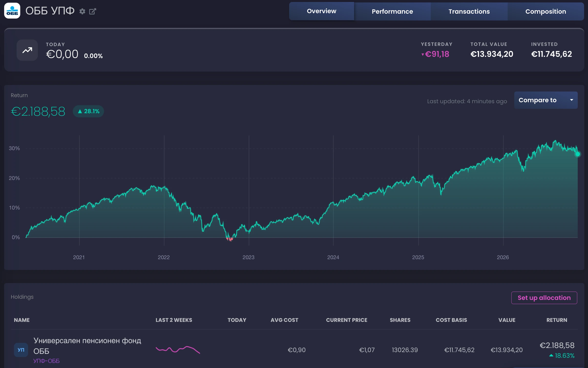
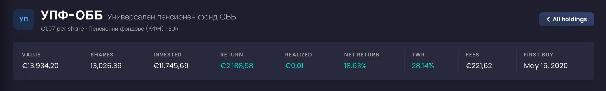
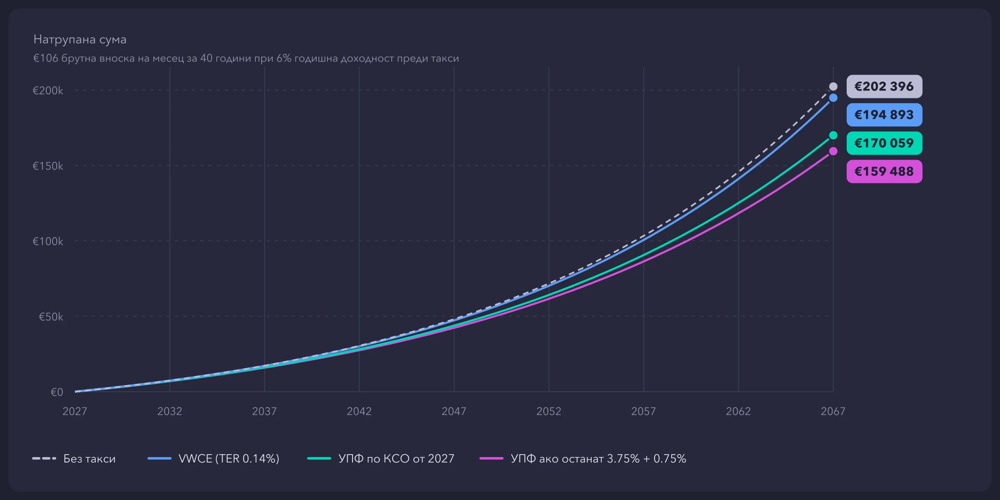
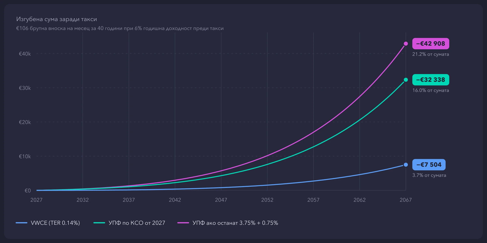
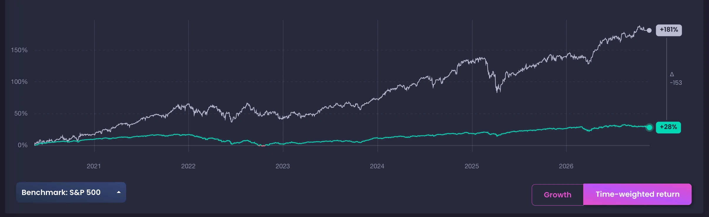
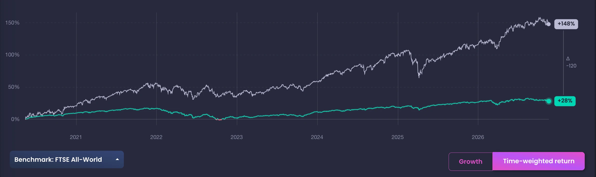
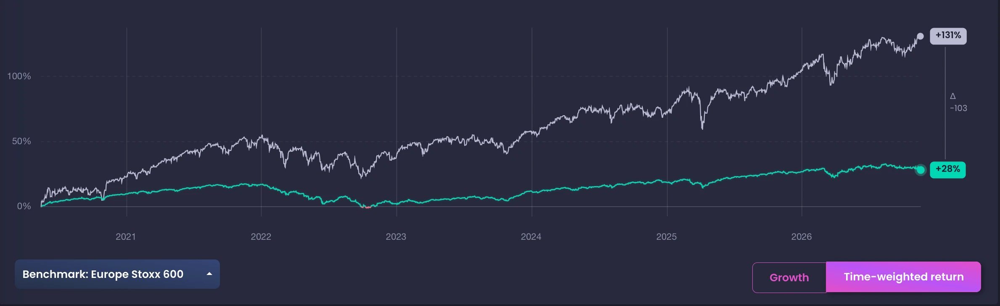
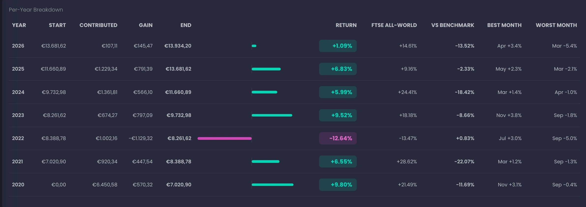
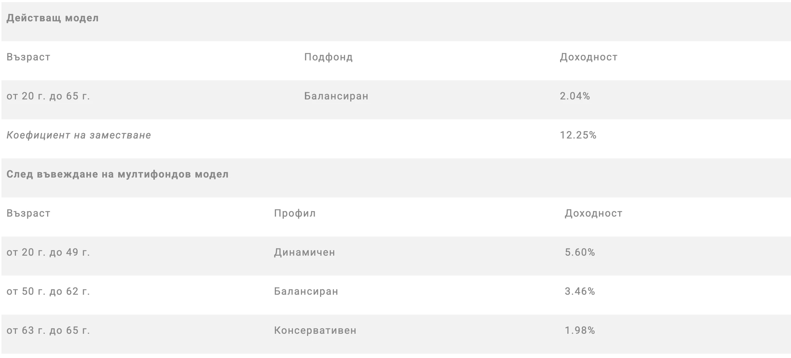

Напоследък много се говори за втория пенсионен стълб и опитите на правителството да си присвои
част от парите ни. Това ме накара да се замисля как всъщност се справят инвестициите ми там - имам
някаква идея, защото всяка година фондът ми ми изпраща summary email, но той не е особено детайлен.

От години разработвам [Stonksfolio](https://stonksfolio.com) - приложение, което дава по-добра
видимост върху различните ми инвестиции в различните брокери, и поддръжката на тези пенсионни
фондове е "натурален фит". Остава само да намерим актуални цени на дяловете на фондовете, които за
щастие КФН [публикуват на сайта си](https://eis.fsc.bg/pension-share/498).

Тук следва по-трудната част - да намерим подробна история на движенията в пенсионния фонд. Аз бях
много приятно изненадан от [ОББ](https://ubb-pensions.bg/), където е моята партида. Просто им
пуснах един мейл и ги помолих да ми изпратят пълната история, и след (не се шегувам) един час ми
бяха върнали един PDF с всички транзакции. Доста ме впечатлиха :)

След като имах историята и исторически данни за цените на различните фондове, трябваше просто да
напиша един parser за PDF-а и автоматично да вкарам [всички данни в
Stonksfolio](https://stonksfolio.com/showcases/8XGteb/portfolios/1GtNdq):

{: .lightbox-trigger}

Доходността на партидата ми в ОББ от май 2020 насам.
{: .caption}

## Анализ

Тъй като преди 2020 партидата ми беше в NN, в справката нямаше данни по месец от преди това, а
просто цялата съществуваща партида наведнъж. Въпреки това може да забележим доста интересни неща:

{: .lightbox-trigger}

Обобщение на партидата: внесени суми, нетна доходност, TWR и платени такси.
{: .caption}

#### Такси

При нетна възвръщаемост от €2188 съм платил €222 таксички, което си е над 10%.

Удръжката на вноска в този фонд е 3.75% (другите може би са различни, но се съмнявам да са такива
будали :)) + 0.75% годишно върху ЦЯЛАТА партида ([source](https://ubb-pensions.bg/calculator)),
което е брутално и напълно в полза на пенсионните дружества, и напълно унищожава потенциалните
ползи от инвестирането. По-добре тея пари да си ги управлявам сам, ако можех :).

От 2027 максималните такси започват да намаляват постепенно до 2036 ([КСО, чл.
201](https://lex.bg/laws/ldoc/1597824512)).

| Година | Удръжка от вноска | Динамичен фонд | Балансиран фонд | Консервативен фонд |
|---|---|---|---|---|
| 2019–2026 | 3.75% | 0.75% | 0.75% | 0.75% |
| 2027 | 3.59% | 0.65% + 1.5% от дохода | 0.65% + 1% от дохода | 0.65% |
| 2028 | 3.42% | 0.60% + 2% от дохода | 0.62% + 1.25% от дохода | 0.60% |
| 2029 | 3.26% | 0.55% + 2.5% от дохода | 0.59% + 1.5% от дохода | 0.55% |
| 2030 | 3.09% | 0.50% + 3% от дохода | 0.56% + 1.75% от дохода | 0.50% |
| 2031 | 2.93% | 0.45% + 3.5% от дохода | 0.53% + 2% от дохода | 0.45% |
| 2032 | 2.76% | 0.40% + 4% от дохода | 0.50% + 2.25% от дохода | 0.40% |
| 2033 | 2.60% | 0.35% + 4.5% от дохода | 0.47% + 2.5% от дохода | 0.35% |
| 2034 | 2.43% | 0.30% + 5% от дохода | 0.44% + 2.75% от дохода | 0.30% |
| 2035 | 2.27% | 0.25% + 5.5% от дохода | 0.41% + 3% от дохода | 0.25% |
| от 2036 | 2.10% | 0.20% + 6% от дохода | 0.38% + 3.25% от дохода | 0.20% |

Годишната такса е процент от нетните активи, а за динамичния и балансирания фонд и процент от
реализирания доход. При доходност от 6% това прави около 0.56% годишно за динамичния фонд от
2036, спрямо 0.75% днес.

Ако сметнем и тези 0.75% на година, които са включени в цената на дяловете, съм платил още €480
индиректно, което прави загубите около €700, или над 30% от възвръщаемостта 🤯.

{: .lightbox-trigger}

Колко ще се натрупа за 40 години при еднакви вноски и доходност, но различни такси.
{: .caption}

{: .lightbox-trigger}

Колко пари изяждат таксите спрямо сценария без такси.
{: .caption}

#### Възвръщаемост

Нетната възвръщаемост за малко над 6 години е 19% [(28% time-weighted)](https://stonksfolio.com/docs/9-net-return-vs-twr), което на хартия не изглежда зле, но ако
сравним с много от популярните индекси изглежда смешно:

##### S&P 500

{: .lightbox-trigger}

Времево претеглената доходност на фонда спрямо S&P 500 от май 2020.
{: .caption}

Очаквано, `S&P 500` напълно "унищожава" нашите пенсионни фондове. Без изненади.

##### FTSE All-World

{: .lightbox-trigger}

Времево претеглената доходност на фонда спрямо FTSE All-World от май 2020.
{: .caption}

Тук също виждаме гигантска разлика. Интересното тук е, че един от най-популярните UCITS ETF-и в
България и Европа, [`VWCE`](https://www.justetf.com/en/etf-profile.html?isin=IE00BK5BQT80), следи
точно този индекс и най-добре показва колко крайно безполезни са българските фондове.

##### STOXX Europe 600

{: .lightbox-trigger}

Времево претеглената доходност на фонда спрямо STOXX Europe 600 от май 2020.
{: .caption}

Съпоставка с европейския брат на S&P 500. Не успява да бие дори FTSE All-World, за жалост.

#### Подробна история

{: .lightbox-trigger}

Доходност по години - фондът изостава всяка година освен 2022.
{: .caption}

На хартия, средната възвръщаемост по година не е толкова зле, но реално дори не успява да
компенсира за инфлацията през този период. Направи ми впечатление и друго. Докато `FTSE All-World`
вади страхотна възвръщаемост през зелените години, биейки в пъти нашия фонд, през 2022 загубите им
са почти идентични. Това показва, че нашият хиперконсервативен фонд е консервативен само в добрите
години, а в лошите времена е почти толкова лош, колкото останалите. Когато всички губят, губим и
ние, но когато другите печелят, ние печелим доста по-малко, а таксичките допълнително убиват това.

Това би трябвало да се промени малко догодина, когато ще преминем на [мултифондов
модел](https://www.fsc.bg/za-potrebitelya/osiguritelna-dejnost/vsichko-koeto-tryabva-da-znaete-za-multifondoviya-model-vaprosi-i-otgovori). Накратко, вместо един фонд за всички, ще има 3 - динамичен, балансиран и консервативен. В динамичния ще попаднат всички хора под 50 и там до 90% от активите могат се инвестират в акции, което би трябвало значително да увеличи възвръщаемостта:

{: .lightbox-trigger}

Доходността при сегашния модел спрямо трите подфонда в мултифондовия модел.
{: .caption}

## Как да направите това за вашите партиди

Ако искате да проверите как са се справили вашите партиди, може да се регистрирате в
[Stonksfolio](https://stonksfolio.com) и да импортнете вашите данни. Подробни указания за това може
да намерите [тук](https://stonksfolio.com/docs/16-pension-funds). За момента автоматично се
поддържа само ОББ, защото нямам екземпляри от другите дружества, но може да помолите някой чатбот
да анонимизира данните ви и да ги преобразува в един CSV, който лесно може да се импортне.

Алтернативно просто попитайте чатбота да ви анализира данните и да ви построи няколко графики :)
